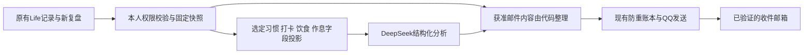

# HatchLife 参考审查、生活复盘页面与固定邮件方案

日期：2026-11-02。状态：需求分析与设计草案，不是已上线功能；不改生产内容、发送计划、AI授权或密钥。现有QQ邮件链路保持运行。

用户随后已授权实施；执行进度见第13节。“本次仅分析”指此前分析时点，不代表当前已全部交付。

用户本轮明确修订：**不包含日记；邮件包含打卡项目；AI负责习惯与打卡分析，并包括新增食谱/饮食与作息分析。** 本修订优先于此前“只允许9整数指标”的旧范围，但只用于明确选定的这些模块，不扩展到日记、备忘录、RSS或其他自由文本。当前实现尚未改变。

## 1. 结论与现状

建议在现有React Life中新增原生“生活复盘”页面，将HatchLife的轻量记录、确认、历史与目标快照设计融入网站；不嵌入整套Flutter、不另建一套账号和云提醒。现有 `/life/reports` 继续承担报告历史与邮件设置。

邮件升级为固定编辑结构：昨日回顾、打卡项目结果、习惯趋势、食谱/饮食分析、作息分析、相关专注与待办提示、今日一步和数据口径。AI综合解释这四类新范围；日记不进入邮件或AI输入。丰富内容来自真实记录与本人选择，AI失败时仍发送完整事实版。

当前代码依据：生产08d9b50，统计版QQ邮件已完成真实收件验收；日报08:00、周一周报08:00，周报合并日报。当前代码的AI输入只有9个整数指标，自动AI关闭；新需求需新增明确范围和协议版本，不能假称现有适配器已经支持。先前一次真实请求unknown及0.05元预算预留保持，不因本方案重跑。聊天长期自动维护任务已删除，不在本次分析中重建。

现有邮件薄的直接原因是 `report-data.ts` 只查询聚合数字，`LifeReportPreview` 白名单没有具体事项/复盘字段，`report-mail-format.ts` 逐项展开计数，QQ传输只发送纯文本。更换提示词或增加装饰无法凭空得到缺少的生活上下文；需要补齐输入、摘要快照和内容权限。

## 2. 参考项目实际包含什么

原始ZIP约1.03GB，共27,617条目，解压总量约3.21GB，大部分是build与.dart_tool；本次仅选择78份源码、测试及文档，约445KB，置于同级references审查目录。未运行Flutter、安装依赖、执行云脚本或访问其中的提醒服务；本结论是源码审查，不是运行验收。

实际实现以饮食和就寝记录为主：

| 能力 | 源码证据 | 适配决定 |
| --- | --- | --- |
| 零散记录汇成一天，今日/昨日入口 | `lib/features/home/home_page.dart`、`models/day_note.dart` | 借鉴低负担记录，不复制已有日记系统 |
| 编辑→分析→可跳过追问→确认→保存 | `features/review/review_flow_page.dart`、`models/ai_protocol.dart` | 借鉴状态流程；第一版可不调用AI而完成记录 |
| AI拆食物，代码计算合计与目标关系 | `services/ai_prompt.dart`、`review_composer.dart`、`nutrition_aggregator.dart` | 借鉴职责划分；饮食AI需要独立数据范围许可 |
| 当时目标快照、历史日历、同日重复保护 | `models/targets_snapshot.dart`、`repositories/review_repository.dart` | 保留目标版本；改为账号+日期+版本并发保护 |
| 中断后可回来、不强迫补齐旧账 | `reminder_planner.dart`、产品愿景文档 | 采用文案原则，先合并进既有日报，不新增多套催促 |
| 缺失信息与不确定性 | `ai_response_parser.dart`、`models/uncertainty_note.dart` | 缺失为null/未记录，估算标注来源，不能补成0 |
| 饮食/睡眠总分 | `services/daily_score.dart` | 不迁移总分；源码低于热量目标同样给该项满分，不能作为可信健康总评 |

V0.3愿景提到多个生活目标，但当前持久模型和主流程仍主要是饮食与就寝。不能把愿景中提到的所有模块当作已实现代码。参考目录未发现明确的项目级许可文件；`publish_to: none`不是开源许可证。实现时优先独立重写设计逻辑，若要直接复制代码，先核对权属与许可。

### 不直接迁移的实现

- AI配置可进入客户端环境/SQLite设置，云提醒客户端还带有固定共享Token和固定服务地址；网页公开发布后不能依赖这些值保密。本网站继续使用后端Secret，不使用参考项目的凭据或服务。
- AI请求包含原始记录、日期和补充问答，与本站现有“仅9个整数指标”的范围不同。不能借项目接入默默扩大外传。
- 解析失败自动再调用一次，以及补充后重新分析，不能照搬到已发生unknown的付费调用。本站仍先持久claim/预算，再外调；未知不盲重试。
- 云提醒按deviceId保存对象，使用共享Token鉴权，包含可请求发信的入口；没有沿用本站owner隔离、收件箱证明和固定收件白名单。
- 云端先 `sendMail` 再保存 `sentDates`，并发或发送后落库失败可能重复。本站保留发送前原子准入及持久投递账本，不替换成这个逻辑。
- 不把“我去睡了”的按钮时间叫作已测得的入睡时间；它最多证明本人记录了准备睡觉/上床时刻。

以上是源码级风险，未对参考服务做线上探测，不宣称已经验证可利用漏洞。

## 3. 网站页面：生活复盘

建议路由 `/life/check-in`。Life首页右侧现有复盘卡片增加“记录今天”与“报告和邮件”两个入口；左侧四栏待办、主布局、液态玻璃与现有顶栏直接入口保持。日历日期详情也可链接到当天复盘。不为了新增页面再挤满顶栏。

页面按使用顺序组织：

1. **这一天已经留下什么**：自动带入当前账号的成果、专注、习惯和阅读记录；说明同步状态，不要求再次录入。
2. **饮食与作息**：三餐/饮食简记、份量和烹饪说明，准备睡觉/上床与起床时刻。区分“计划食谱”和“已经吃过”，计划食谱未经确认不能计入摄入。活动分钟按需填写；不强制身高、体重、年龄或热量目标。
3. **习惯与打卡**：展示本人选定项目，结果为完成/明确未完成/未记录/不适用，可附项目内的短备注、阻碍选项和下一步。备注限定本项目，不将日记正文作为自动补全来源。
4. **保存前确认**：标注哪些内容只在站内，哪些本人选择可进邮件；AI整理不等于确认事实。
5. **过去的记录**：日期列表/日历与目标快照，支持补记、更正，保留修改版本；不覆盖已发邮件。

建议状态：未填写→草稿→已确认；AI另有未请求/处理中/成功/失败/未知，与“复盘是否保存”分开。断网、AI故障或未填健康字段都不应阻止保存。

“打卡”区分项目完成记录与当天复盘是否提交，不评判这一天好坏。允许部分填写；不增加健康总分、人格判断、连续天数清零惩罚或额外每日执行完成率。日记仍保持独立，不作为这页的自动输入。

### 与已有模块的关系

- 四栏工作台仍是待办/构想/成功/每日执行的唯一业务来源。复盘引用这些记录，不自动复制或自动改状态。
- 本人可明确将完成的打卡项目加入成功清单；用稳定来源ID和clientKey防止多次点击生成重复成果。普通记录不自动生成成功项，不与完成待办重复相加。
- “每日执行”仍是记忆清单，不能根据当前completed字段推断每天执行次数或完成率。日期化的“今日三件事”可单独回顾，但与其引用的待办去重。
- 日记/备忘录保持原入口、内容与标签；新复盘只放简短结构化内容和引用，不迁移或重建日记。
- 手机单栏、宽屏分区，不依赖固定高度和横向滚动；验证320/360/768/1024/1440宽度、半屏、200%缩放、键盘和深浅模式。

## 4. 固定日报邮件结构

目标：读完知道“昨天做成了什么、哪里需要留意、今天从哪一步开始”。推荐正文约500–900中文字，详细历史留在站内；段落结构固定，条目有上限。

| 固定项目 | 内容与上限 | 来源与口径 |
| --- | --- | --- |
| 一句话回顾 | 1–2句，把事实连接起来 | 代码模板优先，可使用已验证数字AI结果；不能编造具体经历 |
| 打卡项目明细 | 最多5项，项目名、计划/实绩、状态及本人选择的项目短备注 | 本人选定的打卡项目；明确未完成与未记录分开。关联成果/待办按来源去重，不默认列出其他私人事项 |
| 习惯分析 | 每日事实与近7天观察、最多2条原因假设/可选建议 | 只分析选定习惯；有历史计划分母才算依计划完成率。原因必须本人记录或标为假设，不能推断人格 |
| 当前值得处理的事 | 最多3项，显式优先项、临近72小时、已超时 | **截至生成时的当前待办**；只列本人纳入打卡范围的标题，其他仅给计数/站内入口；超时给继续/拆分/转构想入口 |
| 专注与学习 | 分钟、轮次、可选领域和可比趋势 | 已同步番茄记录；分钟是保存值，不声称独立测量有效学习时长 |
| 食谱/饮食分析 | 已记录三餐/食谱概况、食物单项估算与假设、最多1条改进建议 | 只读取该模块的食物、份量、烹饪信息；摄入与计划分开，AI估算不当作测量。未知不补0，不自动推断减重目标 |
| 作息分析 | 本人记录时刻、与本人目标差异、近7天规律、最多1条建议 | 上床/准备睡觉与实际入睡分开；缺少确认的入睡/起床不能计算实际睡眠时长，不作诊断 |
| 习惯与记忆清单 | 实际勾选记录、本人选定清单提示 | 无历史分母时不算完成率；每日执行只提醒，不变成第二套习惯打卡 |
| 阅读与灵感（辅助） | 标记已读/收藏数量与站内入口 | RSS已有readAt/starredAt；不读取正文、不给AI传标题，不声称证明读完或估计不存在的阅读时长 |
| 今天最小一步 | 1项主要行动，可选2项辅助 | 本人填写或明确选择的事项；无选择时仅提供通用可选行动，不替用户认定任务重要性 |
| AI综合观察 | 把习惯、打卡、饮食、作息连接成最多2条观察和1个今日行动 | 不重复抄写各项数字，不把相关性说成因果；使用已保存结果，失败以完整事实版降级，不阻止整封邮件 |
| 数据范围与入口 | 云端截止时间、缺项说明、查看/暂停入口 | 只统计已同步且有权限的记录；普通站内链接，不把鉴权信息、邮箱或报告私密ID拼入URL |

没有数据的项目写“尚未记录/可选”，不能等同“没有努力”。不为填满栏目自动生成饮食、情绪或学习故事。正文超过上限时保留行动与成功，裁剪明细并指向站内完整报告。

目前QQ适配发送纯文本，第一版直接采用清晰的小标题和短列表，不要求HTML美术重做；不加入远程图片、打开追踪、附件或外部脚本。纯文本仍需做输入边界、MIME编码与控制字符检查。正文设UTF-8字节预算，测试base64膨胀后仍满足现有SMTP 32KiB及消息边界。

### 邮件模板示意（占位符，不是用户实际记录）

```text
夏令时电波 · 生活日报 · {{昨日日期}}

昨天的进展
{{依据真实记录生成的一两句回顾}}

打卡项目
{{最多5条选定项目：名称、结果、缺项、本人项目短备注}}

习惯观察
{{近7天可比记录与1条建议；无有效分母时不展示完成率}}

今天先留意
{{当前明确优先项/72小时待办，最多3条；无事项时说明无需紧急处理}}

专注与学习
{{保存的专注分钟与轮次；有足够可比数据才展示变化}}

食谱与饮食
{{已经吃过的记录、计划食谱区分展示；估算与假设标清}}

作息
{{本人记录的上床/起床时刻、目标差异与1条建议；未知实际睡眠不推算}}

习惯与清单
{{实际习惯记录；每日执行保持清单入口}}

阅读与灵感
{{标记已读/收藏与本人选定条目}}

今天最小一步
{{本人选择的一件可开始的事}}

综合观察
{{基于四模块的AI解释，或失败时的固定事实说明}}

数据截至{{云端快照时刻}}。未同步和未记录内容可能尚未包含。
查看完整报告、补记或暂停提醒：{{登录后站内入口}}
```

## 5. 固定周报结构

周一08:00一封：上周一句话→打卡覆盖与项目进展→习惯的7天趋势→饮食记录/食谱与估算口径→作息规律与缺项→相关专注及当前72小时事项→下周最多3个调整点→昨日日报精简附录→数据范围与入口。日记不进入周报或分析。

周报不是七封日报全文拼接。昨日属于上周时，明确为上周的局部，不重复计数。比较前一周只使用同口径和足够覆盖的记录；样本少或设置刚启用时显示“样本不足”，不制造百分比趋势。迟到补记可能使后来生成的周报与早前日报合计不同，应说明版本和截止时间。

首版不新增晚间催促邮件。缺少复盘时在次日固定日报内温和提示；可选晚间站内提醒另设开关，默认不启用，不影响当前每天一次的邮件习惯。

## 6. 三种内容权限必须分开

| 范围 | 默认/建议 | 不意味着什么 |
| --- | --- | --- |
| 站内私密保存 | 新复盘只对本人开放；新敏感文本建议独立业务密钥加密，密钥不与JWT/邮件vault复用 | 不代表端到端加密；后端为生成报告仍会在受控流程解密 |
| 邮件内容 | 用户已明确选择包含打卡项目；包含本人选定项目与习惯/饮食/作息结果，排除日记 | 邮件也经过QQ/Outlook处理，可能出现在通知预览；不等于只存在网站 |
| AI输入 | 新版本允许选定习惯/打卡项目、食物与份量、作息时刻和必要的受控备注，以及原统计指标 | 不允许读取日记、备忘录、RSS正文、邮箱或owner标识；不能把任何新自由文本一概混入输入 |

新内容按项目配置“进邮件”和“允许AI分析”，可查看实际待发预览并撤回。日记及便签全文、一般自由复盘摘要不作为默认来源；与打卡无关的任务/成果标题不顺带加入。新范围仅作用于未来尚未冻结的报告，不回写历史或补发过去内容。公开页面、日志和仓库不出现这些私人内容。

本次已明确要做饮食与作息分析，实施时新增独立scopeVersion与字段投影，承接这次限定需求，不继续把它描述为仅9数字。饮食内容只能来自专用饮食输入，作息来自本人确认的对应字段；日期可用相对日序、时刻用本地分钟，避免传不必要身份与精确日历日期。上线提供范围查看与撤回，不重复索取已明确的“排除日记”选择；如以后要增加病史、身体指标、其他正文或更高预算，则属于新的扩展。

项目名称或备注本身也可能包含私人信息，去掉账号字段不等于完全匿名。提供逐项排除和实际输入预览；不以模糊的“已脱敏”承诺代替范围控制。



## 7. 数据、接口与历史兼容

以下为设计名称，实施前核对最新迁移号，不在本次执行DDL。

- `life_checkins`：owner_id、record_date、状态、revision、client_key、加密自由文本与明确的可选结构化事实、创建/更新/提交时刻；只对新表增加(owner,date)约束，不重建旧日记或更改用户ID。
- `life_checkin_revisions`：有限长度的更正历史/目标版本引用，记录何时补记了哪一天；控制保留量，避免每个按键写一行。
- `life_checkin_targets`：本人配置的选填目标与有效日期；历史结论使用当时目标，改变设置不重算旧记录。
- 报告保留现有v1数字快照；丰富内容使用关联扩展快照与内容版本，不把新字段直接塞进旧v1白名单或覆盖已发送快照。扩展快照固定本人许可的具体事项和当时来源，不在每次打开历史时重新拼当前任务名。
- 复盘与邮件设置owner-only；记录端点按已登录owner和日期访问，服务端确定owner，拒绝客户端伪造所属人。任何协作者扩展需独立授权，不默认暴露新的健康或复盘数据。
- 新记录采用稳定clientKey、revision CAS、离线队列账号隔离；同日多设备编辑发生冲突时保留本地草稿、提示比较，不静默last-write-wins。习惯/打卡计划保存有效期，分母只取当日有效计划；历史日志按来源聚合去重，不盲目给旧表增加唯一约束。
- 报告扩展和AI结果是派生数据，不能因AI返回或发送邮件而改写待办、习惯、日记及用户原文。
- 新备份明确升级个人数据版本（预计v5），继续读取v1–v4及旧加密外层；纳入复盘/目标/适用扩展，排除Secret、全局消费、防重、验证凭据、投递队列和自动外调同意。恢复保持AI/邮件关闭，不清IndexedDB、不覆盖既有消费账本。

当前新schema从0032或实际最新号继续，0027–0031不改。新增模块通过能力门上线，后端和新表就绪后再发布入口；未配置新加密密钥时不接受敏感新记录，不牵连已有网站功能。

## 8. 日期、快照与去重口径

- 时区仍Asia/Shanghai；日报回顾昨天、周报回顾完整上周。准备睡觉/上床时间使用完整时间戳，并明确归属记录日；凌晨事件不静默归错日期。起床记录不直接变成真实睡眠时长。
- 保存草稿、确认复盘、选邮件内容、请求AI是独立动作。每天可以多次编辑，但只有确认版本进正式报告；缺失和暂未同步须明确标记。
- 报告生成时在同一受控事务/一致读取边界冻结数字和扩展内容，避免计数与标题来自不同版本。当前待办以生成时刻标记，不能伪装成昨日截止时状态。
- 快照后补记不重发旧邮件；在下一份报告用有限的“补记更新”指出记录日期与站内入口，业务指标仍按归属日计算，不重复计入当天成果。
- 成果、完成待办、复盘引用同一事项按稳定来源去重。习惯日志表示记录次数，RSS表示标记事件，不能把开过网页或有readAt当作证明完整阅读。
- 沿用同周期固定job key、固定消息快照、原子发送准入、未知不重发。模板升级不重放旧报告或绕过旧AI unknown；新增AI用途也不能借新key重跑已未知的同一操作。

## 9. AI与资源可靠性

统计、趋势计算、72小时倒计时、事项筛选、去重、历史覆盖和邮件渲染由代码执行。AI分析选定习惯与打卡的模式、食物结构与单项营养估算、作息记录与可能调整；不作诊断、打人格分或推断未提供的经历。

建议首版每份主报告一次综合请求，输出固定JSON四模块：habits/checkins/diet/sleep，另有综合观察、建议、估算假设与数据缺口。食物可由AI给单项估算，合计与目标关系仍由代码计算；没有份量时标不确定，不编造精确摄入。作息差异由代码计算后交给AI解释；“为什么没打卡”仅能引用本人项目备注或标成待验证假设。

不要求四个模块分别调用模型；首版不自动追加追问或JSON纠错请求。输入不完整时按缺失返回，用户照常保存。周报复用已确认的每日结构化记录与估算来源，不把整周原始文本再次无限拼接。更丰富邮件在AI失败时仍发送事实和本人记录，不能退回只有几个计数。

适配器仍固定官方DeepSeek地址和既定非思考模型，不采用参考项目的可任意配置客户端URL。输入按选定项目数、近7天范围、备注/饮食描述字节数设上限；输出做严格JSON结构、枚举、长度、数值范围和禁止URL/HTML校验。项目备注和食谱文本始终当作不可信数据，不能成为系统指令、工具调用、SQL或邮件配置。AI没有改任务、改习惯、改收件人或直接发信权限；事实更正和目标调整由本人确认。

网站共享月预算仍不超过人民币10元；保留先原子预留再请求、结果持久化和失败降级。每份日/周主报告最多一次；周报附录不另调AI，普通保存/打开页面/输入文字不触发调用。新输入范围或更长输出必须重新核对当前官方价格与最坏token上界，不能机械复用旧预留额作为实际费用保证，不自动换更贵模型或加预算。

日报扩展只读取索引化的当前owner及有限日期范围，使用有限条目和快照；不为了报告重新抓取RSS或遍历所有正文，保留RSS每日一次策略和互动写入储备。草稿本地防抖，离线同步合并；预留AI费用与D1读写是两种预算，不能混为数据库容量。

旧DeepSeek unknown继续只读保留。新AI实现必须先定位服务链路问题并以新的正常报告在受控范围内验收；不能拿新scope或模板版本作为重跑旧未知请求的借口。本次分析不调用付费API或启用新范围。

## 10. 实施阶段与验收门

| 阶段 | 交付 | 完成条件 |
| --- | --- | --- |
| A：页面与记录 | 原生生活复盘、选定习惯/打卡、饮食/食谱、作息、草稿/确认/历史、计划快照、离线冲突、加密与备份 | 不依赖AI可保存；本人隔离、多设备冲突、错误日期、部分记录、密钥丢失与隔离恢复均通过；不改旧内容 |
| B：四模块AI | 诊断真实链路、新范围投影、四模块JSON、数字计算、估算和缺失说明、持久结果 | 日记等禁止字段在构造请求前被排除；输入预览、撤回、共享10元预算、并发/未知不重试均通过；真实验收不能以mock代替 |
| C：固定日报周报 | 项目明细与四类分析、扩展快照、内容预览、迟到补记口径 | 匿名/跨owner拒绝；输出不含日记和未选内容；纯文本/MIME长度、同周期一次与AI失败事实版通过 |
| D：交互完善 | 缺项补充、本人更正与可选追问、历史趋势 | 新版本有界分析，不因每次编辑自动扣费；不将补充/重试伪装为重放未知操作；不强迫打卡补旧账 |
| E：实际收件验收 | 新模板通过既有QQ通道正常投递 | 先预览，按正常真实报告核对收件；不重复轰炸、不清账本；验收后确认08:00日/周计划与暂停仍有效 |

每阶段先隔离验证、审阅差异和旧备份兼容，再按授权部署，核对两CI、线上私有接口和实际适用业务。新增内容确认前保留现有统计邮件不中断；本次只提交方案，不改变任何开关、发送范围或自动任务。

## 11. 需要明确的产品选择

1. **已确认**：不包含日记，包含打卡项目；AI分析习惯/打卡，并包括食谱/饮食和作息。本次回复已将邮件与AI两条范围分别落到上述字段，不再把用户需求描述为只显示数字。
2. 实施默认：只选定项目，未知不补零、健康不打总分，不强迫热量/体重输入；食谱计划与实际食用分开，AI建议为可选调整而非命令。其他资料不自动加入。

推荐按A→B→C→E完成记录、四模块AI、固定报告与真实收件闭环；D为后续低负担交互完善。这样AI成为明确交付项，同时保留不依赖AI也能保存和发信的可靠性。

## 12. 核对用源码索引

网站：`client/src/features/life/overview.tsx`、`layout.tsx`、`reports.tsx`、`report-workspace.tsx`、`server/src/db/schema.ts`、`utils/report-data.ts`、`life-report.ts`、`report-mail-format.ts`、`report-mail-qq.ts`、`report-ai.ts`及`docs/life-reports-plan.md`。

参考：同级`work/references/hatchlife-review-2026-11-02`中已选择的`lib/features/home/home_page.dart`、`features/review/review_flow_page.dart`、`models/review_entry.dart`、`models/targets_snapshot.dart`、`services/review_composer.dart`、`daily_score.dart`、`real_ai_client.dart`、`ai_config.dart`、`cloud_reminder_service.dart`、`core/database/migrations.dart`及`tool/cloud/index.mjs`。原始ZIP与参考源码不放入网站Git仓库。

## 13. 2026-11-02 实施检查点（功能分支，未发布）

生产08d9b50未改；原统计邮件保持现状。本轮没有生产写入/Secret变更、真实AI调用或发信，也没有重建已删除的聊天小时维护。用户已授权普通技术后续，不重复请求下一步。

### 已实现

- Owner-only原生 `/life/check-in` 及Life右侧入口，顶栏和四栏待办不变。四种项目结果、既有习惯/待办来源ID及去重、可解除关联，不自动改原项目或创建成果。饮食/计划食谱分开、份量选填，上床/起床与当日目标快照，不打总分或虚构完成率。
- 草稿/确认分离、逐项邮件/AI选择与实际内容预览。**保存不外调，四模块AI仍未接通**，旧AI适配器仍是原数值范围。日记、便签、RSS正文没有新输入通道。
- 本机新独立IndexedDB，各编辑页面独立副本、按账号/日期有界读取、可恢复、串行写入与存储失败提示；落盘未完成时离开保护。不迁移/清空旧Life数据库或离线队列。新页面用自己的保存状态，避免旧同步徽标冒称复盘已同步。云端revision CAS；冲突后必须新读取云端版本，比较后再提交。
- 0032草案新增个人记录、十版更正历史和密钥证明门。主记录/历史随同一SQL提交，触发器故障全部回滚；不改旧表唯一约束。Owner/date读取，项目引用跨owner拒绝。
- 独立 `LIFE_CHECKIN_KEY`：32随机字节base64 Secret，不复用JWT/邮件/AI等Secret；HKDF分离AES-GCM/HMAC，AAD绑定owner/date/revision。仅服务端密文，key guard仅非密钥HMAC证明，防误换合法格式Key后继续写新日期。该Secret**尚未在生产配置**；不自行轮换、打印或入库明文。浏览器草稿受本机浏览器存储保护，不宣称端到端加密。
- 个人v5云端事务导出复盘/历史，浏览器合并本机已落盘草稿后用用户口令加密；两者边界不同，不宣称跨端原子快照。复盘导出缺Key时不静默省略，用户可明确选“不含生活复盘”备份。保持v1–v4读取。
- v5新事实均恢复为草稿且关闭外发选择；不含Key/key guard/客户端操作键/验证投递消费账本/持续同意。`lifeCheckinDraftCopies`是便携文件段，**不是SQL表或重放队列**。文件验证不自动写生产；隔离恢复不是生产恢复成功。每次最多20本机恢复副本、备份最多1000副本，超限停止提示，未删除草稿。
- 新固定事实邮件草稿纯函数已实现并测试，**未连接生产发送器**；仍待不可变扩展快照、撤回校验、四模块AI、72h事项/阅读和周报附录，不能称新版日报已投递。条目/JSON/UTF8邮件字节有界；RSS每日策略与已有预算不变。
- Pages增加新后端/迁移/v5能力门，Worker验收增加私有路由403。0032未发布可完善；0027–31冻结。

### 验证

- 最终63文件238项全量、前后端类型通过；最终本机生产构建通过，保留原阅读/Mermaid分包警告。实际HTTP v5、加密往返、同owner新Key隔离恢复、消费保全、未知/操作字段拒绝、错误Key不覆盖/不新建日期通过。
- 真实隔离Miniflare/workerd D1：5相同并发一次版本、5不同并发仅1成功、保留10版、触发器故障回滚。0生产写入/0外调。
- 本机headless启动器不可用；未声称 `life-checkin.cjs` 已通过。CUA对真实构建+loopback虚构API验收：空白新增、确认/刷新、双页面独立草稿与恢复、比较前禁合并、云端503恢复、Key缺失禁保存、账号切换隔离、手机深浅外观。不是生产账号或真实服务验收。证据 `outputs/life-checkin-2026-11-02`。
- 合成账号/网络拦截仅在测试脚本，不进入client/public。新Secret未读取/显示。两CI仅YAML解析，尚未发布，不能称CI完成。

### 下一步

1. 保存功能分支，继续不可变加密报告扩展快照与范围版本，外发前核对撤回/源revision；不重放旧unknown、不改已发邮件。
2. 四模块严格JSON AI适配、代码统计、官方价格/最坏预算复核、持久claim和失败降级；10元共享上限不变，旧5分unknown不退款重试。
3. 接固定日报周报及补记、当前72h/阅读、内容预览和派生快照备份，完善有效计划与历史趋势；无数据不编造。
4. 完整隔离验收后合main，实际main构建/两CI/线上只读。新Key的安全配置与保管、必要本人输入留到结果可审阅时处理，不取旧凭据绕过审批。
5. 用正常真实记录完成新版QQ实际收件验收。**总任务未完成**；此阶段不代启用新范围或改现有邮件。

## 14. 2026-11-02 固定报告扩展与只读预览（功能分支，未发布）

- 在fa72a80记录基础上新增0033草案：新报告与选定复盘扩展一同保存。基础数字、七天来源、选定当前待办倒数和RSS标记统计来自同一读取事务；提交时核对owner/date/revision/HMAC及来源总数，两份记录同成同败。并发输家不能替换扩展，不向旧报告补入今天内容。
- 扩展使用独立模块Key/HKDF目的分离AES-GCM；AAD绑定owner、用途和基础快照SHA。未选项目和日记正文不进入扩展；数据和UTF8字节均有界。Key不存在时保留原统计生成，已有敏感数据解密失败不输出部分备份。
- source guard可用于后续AI/邮件原子claim与预留准入；新增日期、更正、撤回或恢复导致旧凭证失效。当前仅完成存储/查看接线，**尚未接入新版外调**。旧仅数字同意不能给丰富快照发起调用，旧自动数字调度跳过丰富快照，不占用它的分析键。原unknown及5分预留保留不重试。
- 新owner-only历史详情路由与报告页只读预览：展示固定事实、七天观察、计划/实际饮食、本人作息、当前72h事项、阅读标记及周报日报附录。无可靠分母不算完成率，跨午夜钟表覆盖区间不当睡眠质量，缺失不补零。浏览器只收到归档形状，剥离来源HMAC/外调凭证；预览不等于已发。
- 独立邮件与AI选择：任何AI输入未获准进入邮件时，综合AI结果不得直接写入邮件，以免跨通道泄露；只能站内展示或邮件事实版，不能靠输出删词冒充可靠脱敏。
- v5扩展归档保留可读历史但移除全部来源HMAC，带archiveOnly；新表outbound_eligible默认0。隔离恢复仅可回看，不产生自动分析/发送资格，不恢复同意、消费、验证或队列。v1–v4不变。0032/33均未发布可完善，0027–31冻结。
- 验证：64文件247项全量，前后端tsc、两CI YAML解析、实际API地址的Vite构建通过。真实Miniflare D1验证5路只生成1份扩展，扩展触发器失败回滚父报告，撤回后原资格失效。合成真实构建浏览器实测360/800 CSS像素预览无横向溢出，撤回/只读归档/旧报告/Key缺失状态通过，console无warn/error。浏览器原缩放130%保持未改，临时viewport已重置、测试服务关闭。证据outputs/life-checkin-2026-11-02/report-snapshot-*.png、report-snapshot-browser.json、report-snapshot-build.log。
- 不是生产账号/真实AI或新版邮件验收，0生产内容写入、0新增费用/邮件。main保持08d9b50线上、16f3e1e本地文档ahead1及原未跟踪分析文件，均未覆盖；本阶段仅推功能分支。

### 接续实施

1. 四模块字段投影与严格JSON适配、目的分离密文结果；复用同一已保存报告稳定键和月1000分原子预算，claim与实际预留均须核对来源及scope2，不能只做事前GET校验。
2. 实际待发内容与输入范围预览、明确scope2启用/撤回；旧scope1不升级。AI结果包含AI-only输入时禁止用于邮件。
3. 新版固定邮件接现有QQ账本：敏感消息准备内容必须密文持久化，最终claim再核对来源/邮箱/启用资格；未知不重发。无AI也发安全事实版；周报附录不额外付费。
4. 结果便携归档、恢复保全、整条链路隔离验收，随后合main/实际main构建/两CI/线上只读。新Key安全配置与真实正常记录/新版QQ实际收件仍待完成。总任务未完成，不能以本地测试或原统计邮件已收到代替新版交付。

## 15. 2026-11-02 四模块AI核心与密文结果（功能分支，未发布）

- 固定快照阶段90083cb已推送；本阶段继续实现四模块投影/严格JSON适配与持久加密结果，不是仅计划。模块为习惯、打卡、食谱/实际饮食、作息；只取已确认且逐项AI允许的字段，剥离owner/source/item ID与精确日历日期，使用相对日和钟表分钟/跨日偏移，不读取日记、通用摘要或RSS内容。名称/备注仍可能含私人信息，不能称完全匿名。
- 模型四模块输出必须有本模块真实ref证据，空模块禁止编造观察/行动；限定纯文本、字段/条数/字符/32KiB响应/20秒。没有依据不算完成率、不造热量营养数值或睡眠质量，模型正确性仍非结构校验可保证。固定官方deepseek-flash、thinking disabled、无工具/搜索/自动重试。
- 官方中文价格2026-11-02复核：https://api-docs.deepseek.com/zh-cn/quick_start/pricing/ 。按高峰未缓存输入2元/百万、输出8元/百万保守估算：请求总UTF8最多12000字节，加500协议token余量、输出最多2048token，成本上界估算0.041384元，沿用单笔5分预留；超过输入限额保留事实版，不静默删选定项目或拆成多次付费。价格复核截止仍2026-12-01，过期停止新调用；账单以供应商为准，站内共享月1000分且不自动加额。
- 0034草案新增独立scope2结果账本，不往旧数值JSON表塞健康文本。复用原已保存报告稳定request key与原月预算/预留表，避免4模块各调用/重复收费。先owner/期限/快照HMAC/source guard的持久claim，再带同一权限与源检查、claim token的原子预算准入；任何来源撤回、旧unknown、归档失效、角色失效、预算满均不调用。
- 结果用途分离AES-GCM/HMAC绑定owner/request key/原快照；重读不调用。超时/传输/JSON不合法为unknown且保留预留；调用成功后落库失败仍保留pending，过期视unknown不接管。日志只固定运维类别，绝无原provider错误、身份/正文/Key。
- 最终65文件255项全量、前后端类型/diff通过。真实隔离Miniflare D1 5路rich AI仅1个mock和1笔5分预留，兼容此前并发/回滚/撤回测试。不是生产DeepSeek成功，0真实调用费用/0邮件。
- **尚未开放付费API/UI或自动scope2调度**。先完成新结果的个人只读归档与恢复口径，再接owner实际输入预览/明确scope2同意、手动/自动调度；旧数值同意不升级。随后密文邮件准备/最终发送资格、固定事实+AI整合与整条QQ收件验收。0032/33/34均未部署，0027–31不改。新加密Key仍未配置生产，线上08d9b50和已有统计邮件不变。总任务继续未完成，不标complete。

## 16. 2026-11-02 手动四模块入口与AI结果备份接线（功能分支，未发布）

- 用户最新明确授权必要的真实AI联调和测试发送，不因费用本身回避必要测试；仍遵守网站月10元、限定四模块内容与已验证收件邮箱，旧unknown不盲目重放，不造个人生活测试记录，不购买服务或重建聊天自动维护。真实联调待新版完整发布与独立Key配置就绪后执行，不以模拟冒充。
- owner-only GET/POST `/life/reports/history/:id/checkin-analysis` 已接持久核心。读取返回已剥离来源证明的只读快照与状态，POST必须精确scopeVersion2/allowSelectedModules=true，拒绝旧数值授权体。owner/报告隔离、Key/维护总闸、速率和价格/预算限制仍有效，GET/页面打开不产生调用。
- 报告页新增真实输入数据预览、默认未勾的单份同意、手动四模块结果/证据和小行动、重读按钮。提交只一次，超时未确认先关闭按钮重读；pending/unknown无付费重试。账号/报告切换、StrictMode旧请求用generation+AbortController隔离；模型文本纯文本渲染。旧报告不需新Key且隐藏无扩展模块，解密不可用仍保留统计查看。
- v5增加`lifeReportCheckinAnalysisArchives`：成功结果与基础报告/扩展同一DB备份事务读出，验证绑定、解密和HMAC后仅导出只读内容，排除requestKey/claimToken/来源证明/消费/同意/队列，pending/unknown不作为可重放任务带入。浏览器校验引用原快照的合法ref；加密文件往返仍验证owner/数据清单，篡改或错Key不静默省略。归档投影只用于校验/回看，付费请求强制要求live快照，不能用archiveOnly冒充权限。生产恢复入口仍未开放，未宣称已生产恢复。
- 两CI加reportSelectedAIV2能力门与新私有路由匿名403检查，尚未运行线上CI。0032–34未发布，0027–31冻结；main本地原文档和未跟踪方案仍保留，未覆盖。
- 最终65文件257项全量、前后端类型、Vite实际API地址构建通过；之后真实HTTP v5成功结果导出/加密往返补测与权限路由共18项定向、服务端类型/两CI YAML/diff复验通过。隔离SQL和mock为测试，不连接真实服务。
- CUA真实构建+loopback合成API：初始0提交，逐份同意后1模拟提交、四模块展示；刷新/重读仍1，unknown重读仍1且无提交按钮；withdrawn/archive/key-off无付费按钮，legacy隐藏新模块，owner2仍0。实际360/800 CSS像素无溢出，console无warn/error，临时viewport重置/服务关闭。证据outputs/life-checkin-2026-11-02/checkin-analysis-{browser.json,desktop.png,mobile.png,build.log}。不读真实用户正文/Secret，未产生真实费用/邮件。

### 接续重点

1. **不重做手动入口或已通过基础**：继续独立scope2持续同意/撤回和有界自动调度，在claim/准入重复核对同意版本与时刻；旧数字开关不升级，周报日报附录不另收费。
2. 新版QQ邮件接线：固定事实+可分享AI，AI-only输入禁止将综合结果入邮件；敏感准备消息密文保存、最终发送原子核对来源/邮箱/启用资格，unknown不重发，AI失败或未同意仍发安全事实版。
3. 整条管线/恢复/发布验收后合main、实际main构建、两CI与线上只读，再安全配置独立LIFE_CHECKIN_KEY、正常真实内容联调DeepSeek及必要QQ发送与实际收件。旧unknown仍不退款/重放；总任务未完成，不能因手动页面可用或原统计邮件已收而称新版已落实。
